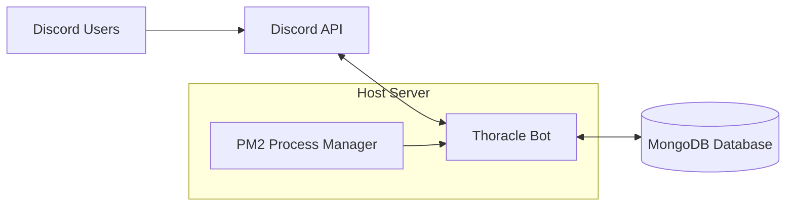
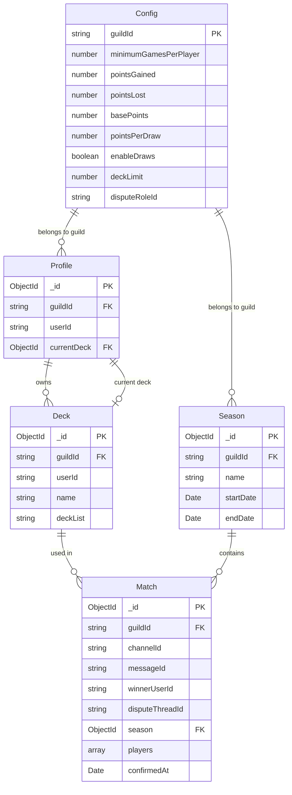
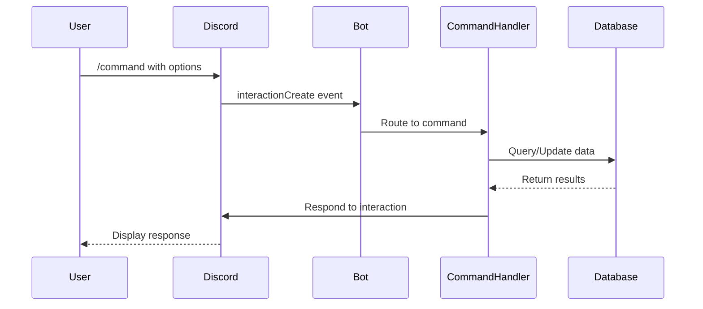
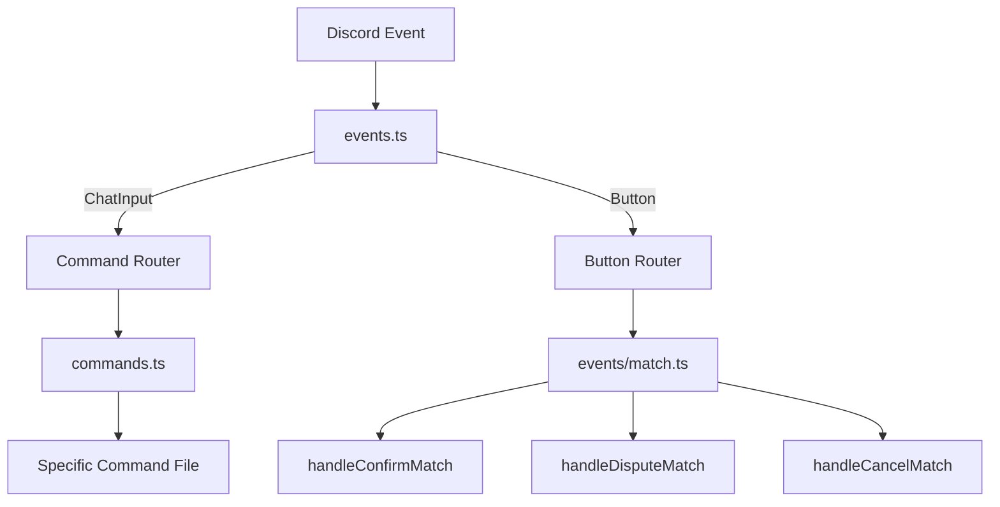
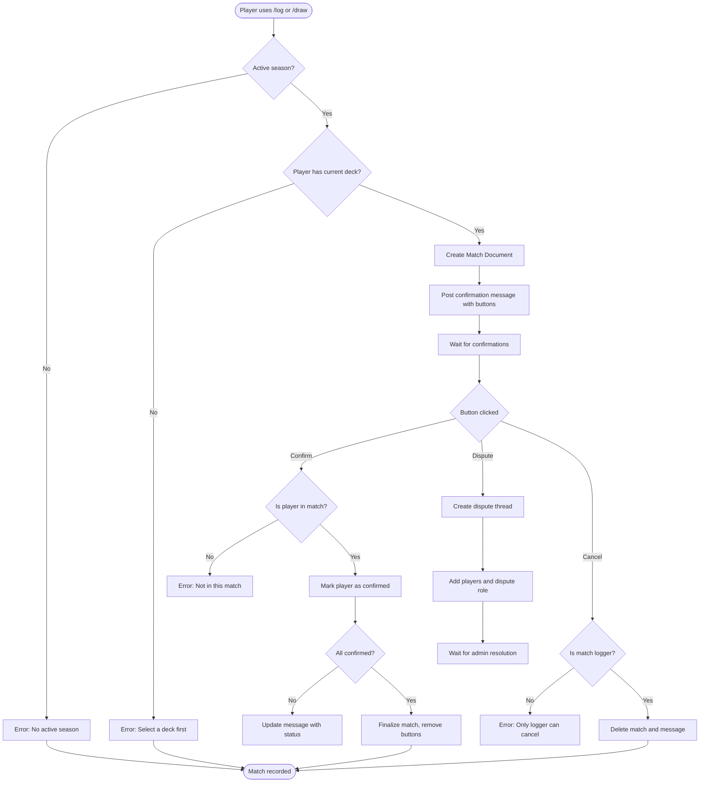
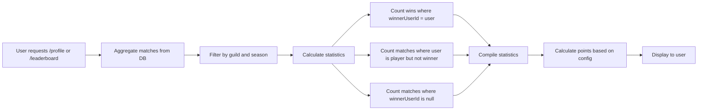

# Architecture Documentation

This document provides a comprehensive overview of the Thoracle bot's internal architecture, code organization, and data flow.

## Table of Contents

- [System Overview](#system-overview)
- [Technology Stack](#technology-stack)
- [Project Structure](#project-structure)
- [Database Schema](#database-schema)
- [Command Flow](#command-flow)
- [Event System](#event-system)
- [Match Confirmation Workflow](#match-confirmation-workflow)
- [Key Components](#key-components)
- [Data Flow Diagrams](#data-flow-diagrams)

## System Overview

Thoracle is a Discord bot built with TypeScript that manages EDH (Elder Dragon Highlander) gaming leagues. The bot handles match logging, player statistics, deck management, and seasonal leaderboards.

### High-Level Architecture



### Architecture Components

1. **Discord API**: Communication layer for receiving commands and sending responses
2. **Thoracle Bot**: Node.js application handling business logic
3. **MongoDB**: Document database storing all persistent data
4. **Process Manager**: PM2 or systemd keeping the bot running

## Technology Stack

### Core Technologies

- **Runtime**: Node.js v16+
- **Language**: TypeScript 5.0+
- **Discord Library**: discord.js v14
- **Database**: MongoDB with Mongoose ODM
- **Environment**: dotenv for configuration

### Development Dependencies

- **TypeScript Compiler**: Transpiles TS to JS
- **ts-node**: Development runtime for TypeScript
- **nodemon**: Auto-restart during development
- **source-map-support**: Better error stack traces

### Package Versions

From `package.json`:
```json
{
  "discord.js": "^14.11.0",
  "mongoose": "^7.3.3",
  "dotenv": "^16.0.3",
  "typescript": "^5.0.4"
}
```

## Project Structure

```
thoracle/
├── src/                          # TypeScript source code
│   ├── commands/                 # Slash command implementations
│   │   ├── config.ts            # Server configuration commands
│   │   ├── deck.ts              # Deck management commands
│   │   ├── draw.ts              # Log draw matches
│   │   ├── info.ts              # Bot information
│   │   ├── leaderboard.ts       # Display leaderboards
│   │   ├── log.ts               # Log match wins
│   │   ├── match.ts             # Match management (admin)
│   │   ├── profile.ts           # Player profile display
│   │   └── season.ts            # Season management (admin)
│   │
│   ├── database/                 # MongoDB models and schemas
│   │   ├── Config.ts            # Server configuration model
│   │   ├── Deck.ts              # Player deck model
│   │   ├── Match.ts             # Match logging model
│   │   ├── Profile.ts           # Player profile model
│   │   └── Season.ts            # Season model
│   │
│   ├── events/                   # Event handlers
│   │   └── match.ts             # Match button interaction handlers
│   │
│   ├── scripts/                  # Utility scripts
│   │   ├── register.ts          # Register global commands
│   │   └── register-dev.ts      # Register guild commands
│   │
│   ├── types/                    # TypeScript type definitions
│   │   └── Command.ts           # Command interface
│   │
│   ├── utils/                    # Helper functions
│   │   ├── interaction.ts       # Interaction utilities
│   │   ├── leaderboard.ts       # Leaderboard calculations
│   │   ├── logger.ts            # Logging utilities
│   │   ├── match.ts             # Match utilities
│   │   ├── validation.ts        # Input validation
│   │   └── warning.ts           # Warning messages
│   │
│   ├── commands.ts               # Command loader and registry
│   ├── database.ts               # Database connection setup
│   ├── env.ts                    # Environment variable validation
│   ├── events.ts                 # Event handler registration
│   └── index.ts                  # Application entry point
│
├── dist/                         # Compiled JavaScript (generated)
├── node_modules/                 # Dependencies
├── .env                          # Environment configuration (not in git)
├── example.env                   # Example environment file
├── package.json                  # Project metadata and dependencies
├── tsconfig.json                 # TypeScript compiler configuration
├── README.md                     # User documentation
├── MAINTENANCE.md                # Maintenance guide
├── DEPLOYMENT.md                 # Deployment guide
└── ARCHITECTURE.md               # This file
```

### Directory Purposes

#### `/src/commands/`
Contains individual slash command implementations. Each file exports:
- `data`: Discord.js `SlashCommandBuilder` defining command structure
- `execute`: Async function handling command logic

#### `/src/database/`
Mongoose models defining MongoDB schemas. Each model includes:
- Interface: TypeScript type for the document
- Schema: MongoDB schema definition
- Model: Mongoose model export
- Helper functions: Common query patterns

#### `/src/events/`
Event handlers for Discord interactions. Currently handles:
- Match confirmation buttons
- Match dispute buttons
- Match cancellation buttons

#### `/src/utils/`
Reusable utility functions used across commands and events.

#### `/src/scripts/`
One-time execution scripts, primarily for command registration.

## Database Schema

### Entity Relationship Diagram



### Database Models

#### Config Model

**Purpose**: Stores server-specific configuration settings.

**Schema** (`src/database/Config.ts`):
```typescript
interface IConfig {
    guildId: string;                    // Discord server ID (primary key)
    minimumGamesPerPlayer: number;      // Min games for leaderboard (default: 10)
    pointsGained: number;               // Points for winning (default: 1)
    pointsLost: number;                 // Points lost per loss (default: 0)
    pointsPerDraw: number;              // Points for draw (default: 0)
    enableDraws: boolean;               // Allow draw logging (default: true)
    basePoints: number;                 // Base points for display (default: 100)
    deckLimit: number;                  // Max decks per player (default: 50)
    disputeRoleId?: string;             // Role to notify on disputes
}
```

**Notes**:
- One document per Discord server
- Created automatically on first configuration
- `fetchConfig()` helper uses upsert to ensure existence

#### Profile Model

**Purpose**: Represents a player within a Discord server.

**Schema** (`src/database/Profile.ts`):
```typescript
interface IProfile {
    guildId: string;        // Discord server ID
    userId: string;         // Discord user ID
    currentDeck?: ObjectId; // Reference to Deck model
}
```

**Notes**:
- Composite key: `guildId` + `userId`
- Statistics calculated by aggregating matches, not stored
- `currentDeck` is the deck used for logging new matches

#### Deck Model

**Purpose**: Stores player deck information.

**Schema** (`src/database/Deck.ts`):
```typescript
interface IDeck {
    guildId: string;    // Discord server ID
    userId: string;     // Discord user ID (owner)
    name: string;       // Deck name
    deckList?: string;  // URL to decklist (optional)
}
```

**Notes**:
- Multiple decks per player allowed (up to `deckLimit`)
- Deck names must be unique per player
- Statistics calculated by aggregating matches with this deck

#### Season Model

**Purpose**: Defines time periods for leaderboard tracking.

**Schema** (`src/database/Season.ts`):
```typescript
interface ISeason {
    guildId: string;    // Discord server ID
    name: string;       // Season name (e.g., "Season 1")
    startDate: Date;    // Season start (default: now)
    endDate?: Date;     // Season end (null = active)
}
```

**Notes**:
- Only one active season per guild (`endDate` is null)
- Matches always associated with a season
- Historical seasons remain in database

#### Match Model

**Purpose**: Records game matches and player confirmations.

**Schema** (`src/database/Match.ts`):
```typescript
interface IMatch {
    guildId: string;            // Discord server ID
    channelId?: string;         // Channel where logged
    messageId?: string;         // Confirmation message ID
    winnerUserId?: string;      // Winner (null = draw)
    disputeThreadId?: string;   // Thread ID if disputed
    season: ObjectId;           // Reference to Season
    players: IMatchPlayer[];    // Array of players
    confirmedAt?: Date;         // When all confirmed
}

interface IMatchPlayer {
    userId: string;         // Discord user ID
    deck?: ObjectId;        // Deck used (reference)
    confirmed: boolean;     // Has player confirmed?
}
```

**Notes**:
- Always has 4 players
- `winnerUserId` is null for draw matches
- Match only counts when all players confirm or admin accepts
- `players[0]` is the match logger (can cancel)

## Command Flow

### Slash Command Lifecycle



### Command Registration

**Development** (Guild-specific, instant):
```bash
npm run register-dev
```

Process:
1. Loads all commands from `src/commands/*.ts`
2. Registers to single guild (from `GUILD_ID`)
3. Commands available immediately

**Production** (Global, up to 1 hour):
```bash
npm run register
```

Process:
1. Loads all commands from `src/commands/*.ts`
2. Registers globally to all guilds
3. Propagation takes up to 1 hour

### Command Structure

Every command file follows this pattern:

```typescript
// src/commands/example.ts
import { SlashCommandBuilder } from 'discord.js';
import { Command } from '../types/Command';

export const data = new SlashCommandBuilder()
    .setName('example')
    .setDescription('Example command')
    .addStringOption(option =>
        option.setName('input')
            .setDescription('Example input')
            .setRequired(true)
    );

export const execute: Command['execute'] = async (interaction) => {
    // Command logic here
    await interaction.reply('Response');
};
```

## Event System

### Event Handler Architecture



### Event Registration

In `src/events.ts`:

```typescript
client.once('ready', () => {
    console.log('Bot is online');
});

client.on('interactionCreate', async (interaction) => {
    if (interaction.isChatInputCommand()) {
        await handleChatInputCommand(interaction);
    } else if (interaction.isButton()) {
        await handleButton(interaction);
    }
});
```

### Button Interactions

Match confirmation messages include three buttons:
- **Confirm**: Player confirms match result
- **Dispute**: Opens thread to dispute result
- **Cancel**: Logger cancels the match (only)

Button handling in `src/events/match.ts`:

1. Finds match by `messageId`
2. Routes to appropriate handler based on `customId`
3. Updates match state in database
4. Updates Discord message/thread

## Match Confirmation Workflow

### Match Logging Flow



### Match States

1. **Pending**: Created, waiting for confirmations (`confirmedAt` is null)
2. **Disputed**: Player clicked dispute button (`disputeThreadId` is set)
3. **Confirmed**: All players confirmed (`confirmedAt` is set, all `players.confirmed` are true)
4. **Cancelled**: Match deleted from database

### Confirmation Logic

From `src/events/match.ts`:

```typescript
// Player clicks "Confirm" button
matchPlayer.confirmed = true;
await match.save();

// Count confirmed players
const confirmedPlayers = match.players.filter(p => p.confirmed);

// If all confirmed, finalize
if (confirmedPlayers.length === match.players.length) {
    // Remove buttons, match is final
    await message.edit({ components: [] });
}
```

### Dispute Resolution

1. Player clicks "Dispute" button
2. Bot creates thread on the match message
3. Bot adds:
   - All 4 players in the match
   - All members with the dispute role (from config)
4. Admin investigates and either:
   - Accepts match: `/match accept <id>`
   - Deletes match: `/match delete <id>`, then correct player logs again

## Key Components

### Entry Point (`src/index.ts`)

**Responsibilities**:
- Initializes Discord client
- Sets up intents (Guilds, GuildMembers)
- Loads event handlers
- Logs into Discord

**Code**:
```typescript
export const client = new Client({
    intents: [
        IntentsBitField.Flags.Guilds,
        IntentsBitField.Flags.GuildMembers
    ],
});

require('./events');  // Register event handlers
client.login(TOKEN);
```

### Environment Configuration (`src/env.ts`)

**Responsibilities**:
- Loads `.env` file using dotenv
- Validates all required environment variables
- Throws errors if variables are missing
- Exports typed constants

**Required Variables**:
- `TOKEN`: Discord bot token
- `CLIENT_ID`: Discord application ID
- `GUILD_ID`: Development server ID
- `DATABASE_URI`: MongoDB connection string
- `SUPPORT_SERVER`: Support server invite link

### Database Connection (`src/database.ts`)

**Responsibilities**:
- Establishes MongoDB connection using Mongoose
- Exports connection object for model registration
- Connection string from `DATABASE_URI` environment variable

**Code**:
```typescript
import mongoose from 'mongoose';
import { DATABASE_URI } from './env';

export const connection = mongoose.createConnection(DATABASE_URI);
```

**Note**: Uses `createConnection()` instead of `connect()` to support multiple connections if needed.

### Command Registry (`src/commands.ts`)

**Responsibilities**:
- Dynamically loads all command files from `src/commands/`
- Builds a map of command name → command handler
- Exports command registration functions
- Provides command lookup for event handler

**Key Functions**:
- `registerGuildCommands()`: Register to development guild (instant)
- `registerGlobalCommands()`: Register globally (up to 1 hour)

### Event Handler (`src/events.ts`)

**Responsibilities**:
- Listens for Discord events
- Routes slash commands to appropriate handlers
- Routes button clicks to match handlers
- Handles errors gracefully

**Event Flow**:
```
Discord Event → events.ts → Command/Button Handler → Response
```

## Data Flow Diagrams

### Match Statistics Calculation



### Leaderboard Generation

Leaderboards are calculated in real-time from match data:

1. Query all matches for current season
2. For each player, aggregate:
   - Total matches (confirmed only)
   - Wins (where `winnerUserId` = player)
   - Losses (where player is in `players` but not winner and not draw)
   - Draws (where `winnerUserId` is null)
3. Calculate points:
   ```
   points = (wins × pointsGained) - (losses × pointsLost) + (draws × pointsPerDraw) + basePoints
   ```
4. Filter players with minimum games
5. Sort by points descending
6. Display top players

**Performance Note**: For large datasets, consider caching leaderboards or using MongoDB aggregation pipelines.

### Deck Statistics

Similar to player statistics but filtered by deck:

```typescript
// Pseudo-code
const matches = await Match.find({
    'players.deck': deckId,
    confirmedAt: { $exists: true }
});

const wins = matches.filter(m => 
    m.players.find(p => p.deck === deckId && p.userId === m.winnerUserId)
).length;

const totalGames = matches.length;
const winRate = (wins / totalGames) * 100;
```

## TypeScript Configuration

### Compiler Options (`tsconfig.json`)

```json
{
    "compilerOptions": {
        "target": "ESNext",              // Modern JavaScript features
        "module": "CommonJS",            // Node.js module system
        "outDir": "dist",                // Compiled output directory
        "esModuleInterop": true,         // Better module compatibility
        "strict": true,                  // Enable all strict type checking
        "noImplicitAny": true,           // Require explicit types
        "inlineSourceMap": true          // Source maps for debugging
    },
    "include": ["src"]
}
```

### Build Process

1. TypeScript compiler reads `src/**/*.ts`
2. Type checks all code
3. Transpiles to JavaScript
4. Outputs to `dist/**/*.js`
5. Includes inline source maps for error tracking

## Performance Considerations

### Database Indexing

Recommended indexes for optimal performance:

```javascript
// Config
db.configs.createIndex({ guildId: 1 }, { unique: true });

// Profile
db.profiles.createIndex({ guildId: 1, userId: 1 }, { unique: true });

// Deck
db.decks.createIndex({ guildId: 1, userId: 1 });
db.decks.createIndex({ guildId: 1, userId: 1, name: 1 }, { unique: true });

// Match
db.matches.createIndex({ guildId: 1, season: 1 });
db.matches.createIndex({ messageId: 1 });
db.matches.createIndex({ guildId: 1, confirmedAt: 1 });

// Season
db.seasons.createIndex({ guildId: 1, endDate: 1 });
```

**Note**: Mongoose may create some indexes automatically from schema definitions.

### Memory Usage

Typical memory footprint:
- **Base**: 50-100 MB (Node.js + Discord.js)
- **Per guild**: ~1-5 MB depending on cache size
- **Peak**: 200-500 MB under load

For large servers (1000+ active players), consider:
- Implementing result pagination
- Using MongoDB aggregation pipelines
- Caching leaderboards with TTL

### Rate Limiting

Discord.js handles rate limiting automatically:
- Queues requests to avoid hitting limits
- Waits for rate limit reset
- No manual handling needed

## Security Architecture

### Permission Checks

Commands implement permission checks:

```typescript
// Example from config command
if (!interaction.memberPermissions?.has(PermissionFlagsBits.ManageGuild)) {
    return await interaction.reply({
        content: 'You need Manage Server permission',
        ephemeral: true
    });
}
```

### Input Validation

User input validated before database operations:
- Deck names: Max length, alphanumeric
- URLs: Pattern matching for supported deck sites
- User mentions: Verified as guild members

### Environment Security

- `.env` file in `.gitignore`
- No hardcoded secrets in source code
- Environment variables validated at startup

## Extension Points

### Adding New Commands

1. Create `src/commands/newcommand.ts`
2. Export `data` (SlashCommandBuilder) and `execute` function
3. Rebuild: `npm run build`
4. Re-register commands: `npm run register`

### Adding New Database Models

1. Create `src/database/NewModel.ts`
2. Define interface and schema
3. Export model using connection from `src/database.ts`
4. Use in commands/events

### Adding Event Handlers

1. Add handler in `src/events.ts` or new file in `src/events/`
2. Register event listener on `client` object
3. Rebuild and restart

## Troubleshooting Common Issues

### Command Not Showing

- Commands registered globally? Takes up to 1 hour
- Use `npm run register-dev` for instant guild-specific registration
- Check bot has `applications.commands` scope

### Database Connection Errors

- Verify `DATABASE_URI` in `.env`
- Check MongoDB Atlas IP whitelist
- Ensure database user has read/write permissions

### TypeScript Compilation Errors

- Run `npm run build` to see detailed errors
- Check types in `src/types/`
- Ensure dependencies are installed: `npm install`

## Additional Resources

### Discord.js Documentation
- **Guide**: https://discordjs.guide/
- **API Docs**: https://discord.js.org/docs/

### MongoDB & Mongoose
- **Mongoose Docs**: https://mongoosejs.com/docs/
- **MongoDB Manual**: https://docs.mongodb.com/manual/

### TypeScript
- **Handbook**: https://www.typescriptlang.org/docs/handbook/

## Architectural Decisions

### Why TypeScript?

- Type safety prevents runtime errors
- Better IDE support and autocomplete
- Easier refactoring
- Self-documenting code

### Why Mongoose over Native Driver?

- Schema validation
- Middleware hooks
- Cleaner query syntax
- Type definitions included

### Why discord.js v14?

- Native TypeScript support
- Better performance than v13
- Improved interaction handling
- Active development and support

### Why PM2 for Process Management?

- Automatic restart on crash
- Zero-downtime deployment
- Built-in monitoring
- Log management
- Cluster mode support (if needed)

## Future Considerations

### Potential Improvements

1. **Caching Layer**: Redis for leaderboard caching
2. **Sharding**: For bots in 2500+ guilds
3. **Web Dashboard**: View statistics via web interface
4. **Enhanced Analytics**: More detailed statistics and graphs
5. **Automated Backups**: Scheduled database backups
6. **Testing**: Unit and integration tests
7. **Logging**: Structured logging with Winston or Pino

### Scalability Notes

Current architecture supports:
- ✅ Up to 100 guilds easily
- ✅ Up to 1000 active players per guild
- ⚠️ Beyond this, consider caching and optimization

For massive scale (10,000+ guilds):
- Implement Discord bot sharding
- Use database connection pooling
- Add Redis caching layer
- Consider microservices architecture

